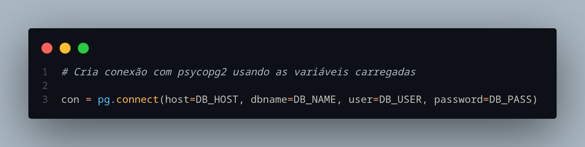
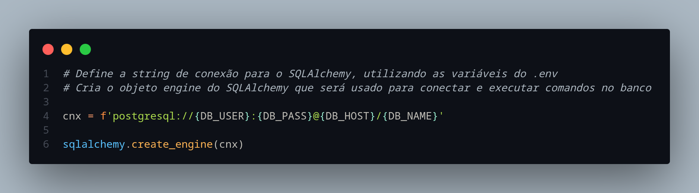
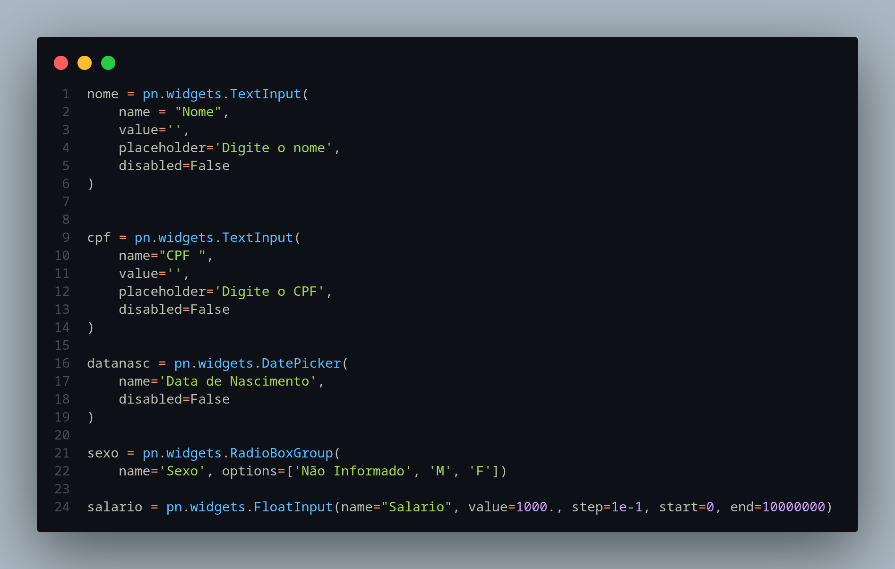
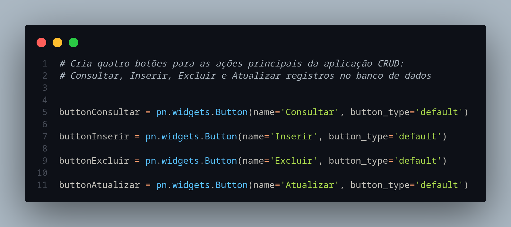
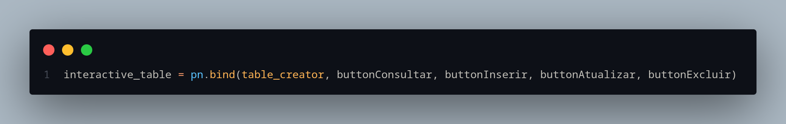
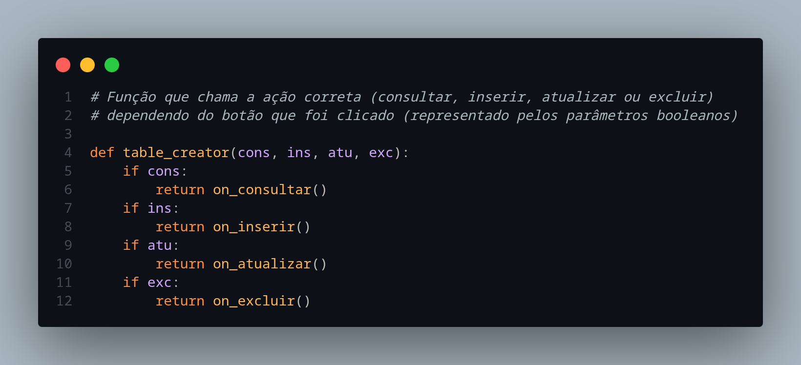
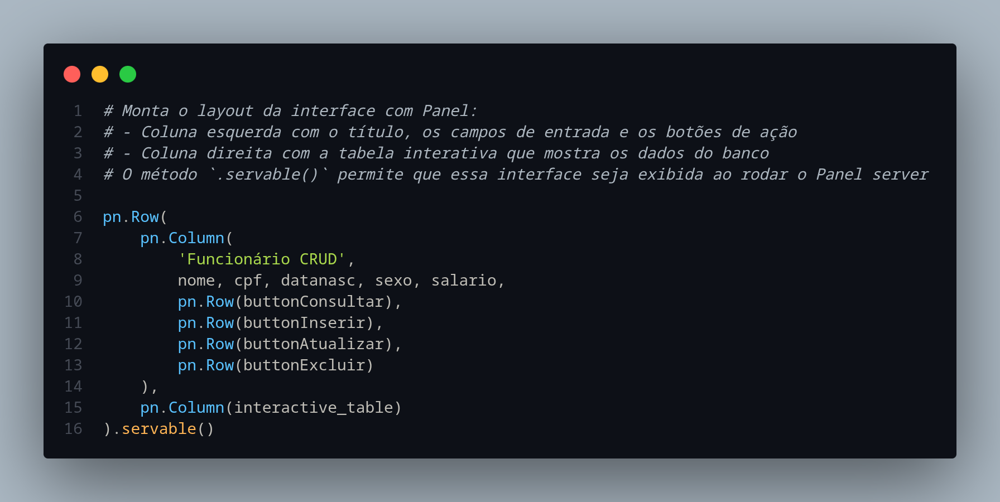

# CRUD no Jupyter Notebook: passo-a-passo

Repositório: https://github.com/liviaalmada/conexao-bd.git

A função deste tutorial é guiá-lo na utilização de uma ferramenta CRUD pré preparada para o trabalho da disciplina de Fundamentos de Bancos de Dados.

Note que os exemplos de SQL e BD utilizados são simples e servem para fins de tutorial. Você deve modificar o código de forma que funcione com o seu próprio Banco de Dados.

# Pré-requisitos

1. Python
2. Jupyter Notebook
3. ipykernel (caso deseje executar os códigos no VS Code)
4. Ter um Banco de Dados definido e executando no Postgres 

# Passo-a-passo

1. Acesse [https://github.com/liviaalmada/conexao-bd.git](https://github.com/liviaalmada/conexao-bd.git) e faça um fork do repositório no seu próprio GitHub
2. Use git e faça um clone local na sua máquina do repositório que você acabou de adicionar ao seu próprio GitHub
3. Abra o repositório em algum editor de código (Usarei VS Code)
4. Acesse a pasta “python”
5. Execute no terminal:
    
    Se estiver usando Linux / MacOS ou WSL:
    
    ```bash
    python3 -m venv venv
    source venv/bin/activate
    ```
    
    Se estiver usando Windows:
    
    ```markdown
    python -m venv venv
    venv\Scripts\activate
    ```
    
6. Verifique se o conteúdo do arquivo requirements.txt é:

```
txt
pandas
sqlalchemy
psycopg2-binary
panel
python-dotenv
```

1. Execute

```bash
pip install -r requirements.txt
```

## Conectando com o BD

1. Crie um arquivo .env
    1. Insira as credenciais do seu BD
        
        DB_HOST=localhost 
        DB_NAME=fbd-conexao (nome do seu Banco)
        DB_USER=postgres
        DB_PASS=root (senha para acessar o Banco)
        
    2. Garanta que o “.env” esteja no arquivo **.gitignore**, para que seus dados e sua senha não sejam expostos ao subir no GitHub

<aside>
🔎

Estre trecho é responsável por usar as variáveis de ambiente que foram definidas e realizar a conexão direta com o BD



estabelencendo conexão com psycopg2



criando uma engine com sqlalchemy 

</aside>

## Executando

```bash
panel serve CRUD-(nome).ipynb --autoreload --show
```

# Personalizando o seu código

Note que, no arquivo **CRUD-panel.ipynb**, existem formas de se manipular os dados do BD que foi usado como exemplo, que possui atributos como **Nome**, **CPF**, **Data de nascimento**…

O seu objetivo aqui é realizar as alterações necessárias para que fique com a cara do seu próprio Banco de Dados.

# Crie um arquivo CRUD-(nome).ipynb para cada tabela do seu BD

## Atributos

No trecho abaixo, ficarão os campos dos atributos da tabela



Atributos da tabela Pessoa 

## Botões

O trecho a seguir você não precisará alterar, pois ele serve para mostrar botões na interface que realizarão cada uma das tarefas Consultar, Inserir, Excluir e Atualizar.



<aside>
🔎

### Como o código assimila as funções ao seu botão específico?

Indicando que a ordem dos botões será Consultar, Inserir, Atualizar e Excluir e chamando a função table_creator para que ela chame a função correta.



Usando ***bind*** para vincular aos botões

Na função table_creator, a ordem estabelecida acima é obedecida e então a função correta para realizar a tarefa é chamada



descobrindo qual botão foi apertado de acordo com o que foi anexado no ***bind*** e chamando a função correta

Por fim, é necessário montar o layout da interface para que apareça corretamente na hora da execução



montando *layout*

</aside>

# Resumo

Para cada tabela, um arquivo .ipynb que deve conter as informações:

| O que mudar | Onde |
| --- | --- |
| Nome do arquivo | `CRUD-suatabela.ipynb` |
| Widgets de entrada | Trocar `nome`, `cpf`, `datanasc`, `sexo`, `salario` pelos atributos reais da sua tabela |
| Queries SQL | `select * from pessoa`, `insert into pessoa(...)`, etc.  alterar com os nomes da sua tabela e colunas |
| Botões | **Não precisa mudar** |
| `table_creator` / `pn.bind` | **Não precisa mudar** |